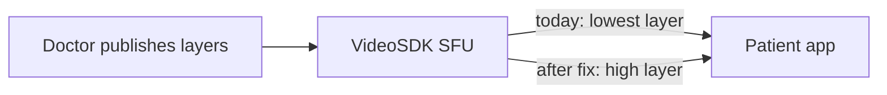

# Clearer remote doctor video

## Why it looks bad

The consultation uses VideoSDK (`@videosdk.live/react-native-sdk`). The doctor is the only remote video, rendered with a raw `RTCView` in [DoctorStageView.tsx](src/Features/Dashboard/MeetingScreen/Components/DoctorStageView.tsx), [InAppPipWindow.tsx](src/components/meeting/InAppPipWindow.tsx), and [AndroidPipStage.tsx](src/components/meeting/AndroidPipStage.tsx).

VideoSDK publishes the camera as several layers (low / med / high). `RTCView` does not pick a layer by itself. This app never calls `setQuality`, so the patient stays on the lowest layer (about 180p) and that frame is stretched across the phone. That is the blur.

`maxResolution: 'hd'` in [MeetingSessionHost.tsx](src/components/meeting/MeetingSessionHost.tsx) only caps the **patient’s own** camera. It does not change the doctor’s incoming video.

A second, smaller problem: each render does `new MediaStream([webcamStream.track]).toURL()`. That gives `RTCView` a new URL every time and makes the native view rebind.

`setQuality('high')` can only select a layer the doctor app actually publishes. If the doctor app sends a single low-resolution track, this change cannot invent extra detail. On a weak network VideoSDK may still drop a layer, then climb back to high when the link recovers.



## Changes

### 1. Request the high layer once per doctor track

Add this hook in [useMeetingParticipants.ts](src/hooks/commons/meeting/useMeetingParticipants.ts) and call it once from `MeetingSessionController` in [MeetingSessionHost.tsx](src/components/meeting/MeetingSessionHost.tsx), next to `useMeetingParticipants()`. That component stays mounted for the full call, including PiP, so the request is not lost when the stage unmounts.

```ts
export const useDoctorVideoQuality = (doctorId: string | null) => {
  const { webcamOn, webcamStream, setQuality } = useParticipant(doctorId || '');
  const trackId = webcamStream?.track?.id ?? null;

  useEffect(() => {
    if (!doctorId || !webcamOn || !trackId || typeof setQuality !== 'function') {
      return;
    }

    let cancelled = false;
    setQuality('high').catch(error => {
      if (!cancelled) {
        console.warn('[useDoctorVideoQuality] setQuality(high) failed:', error);
      }
    });

    return () => {
      cancelled = true;
    };
  }, [doctorId, webcamOn, trackId, setQuality]);
};
```

In `MeetingSessionController`:

```ts
const doctorParticipantId = useMeetingStore(state => state.doctorParticipantId);
useDoctorVideoQuality(doctorParticipantId);
```

`high` is the top published layer (typically 720p). It is a preference: VideoSDK still steps down if the network cannot hold it. Do not also call `setViewPort` — that path chooses a layer from view size and can pull the full-screen doctor back down.

### 2. Keep one stream URL for the remote views

In the three remote `RTCView`s, memoize the URL on the track object so the native renderer is not recreated every render:

```tsx
const remoteTrack = webcamOn && webcamStream ? webcamStream.track : null;
const remoteStreamURL = useMemo(
  () => (remoteTrack ? new MediaStream([remoteTrack]).toURL() : null),
  [remoteTrack],
);
```

Then `streamURL={remoteStreamURL}` and render the view only when `remoteStreamURL` is set. Leave `objectFit` as it is: `contain` on the full stage, `cover` in the small PiP windows. Cropping is not a quality fix.

Local self-view in [LocalPipCard.tsx](src/Features/Dashboard/MeetingScreen/Components/LocalPipCard.tsx) is the patient’s camera, so it stays unchanged.

## How to confirm after implementation

Join a call with the doctor camera on. The main stage should sharpen within a second or two of the doctor video appearing (the first frames can still be the low layer until `setQuality` completes). Toggle the doctor camera off and on and confirm it sharpens again, because a new track id re-runs the request. Minimize to in-app PiP and Android PiP and confirm the same track stays attached without flickering. If it stays soft after `setQuality` succeeds, the doctor app is not publishing a high layer — that has to be fixed on the doctor side (`multiStream: true` and an HD encoder such as `h720p_w1280p`).
