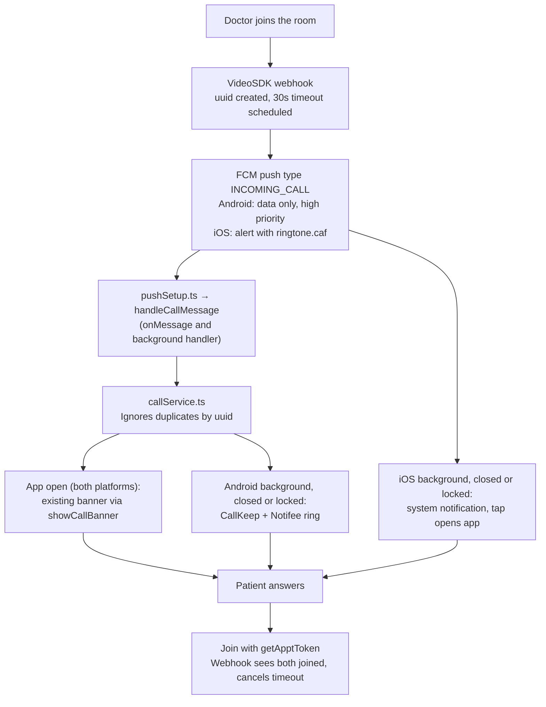

# PredCare Incoming Call Ringing Plan (react-native-callkeep)

**Status:** implemented in the app on 2026-11-03 (phase 1, Android and iOS). Not yet tested on devices.
**Code:** `src/services/calls/` holds the source of truth; the snippets below show the design and may differ in small details.
**Backend:** already built in `dev-api` (`src/services/callRinging.service.ts`, `src/queues/call-timeout.*`, `src/modules/webhooks/videosdk-webhook.service.ts`). This plan follows the backend as it is today.
**Checked on:** 2026-11-03.

## Rules for this work

1. **Calls ring from the push notification in every app state:** open, background, closed and locked.
2. **The socket stays as it is.** `SocketListeners.tsx` isn't touched, and the new code doesn't use the socket `incoming_call`.
3. **No existing code is removed or rewritten.** All new logic goes in new files under `src/services/calls/`. Existing files only get added lines that call into it.

These existing files aren't changed at all: `SocketListeners.tsx`, `GlobalIncomingCallBanner.tsx`, `IncomingCallBanner.tsx`, `useIncomingCallStore.ts`, `useJoinVideoCall.ts`, `pushDisplay.ts` and `useDevicePermissions.ts`.

## Overview

When a doctor joins the consultation room, the backend sends an FCM call push (`type: INCOMING_CALL`) to the patient's active devices. After 30 seconds it sends a cancel push (`type: CALL_CANCELLED`) if the patient hasn't joined. The patient app rings from that push:

| Platform | App open | Background or closed | Locked |
| --- | --- | --- | --- |
| Android | Push → existing in-app banner rings | Push → self-managed CallKeep + Notifee notification rings with Answer and Decline | Ringing notification on the lock screen |
| iOS | Push → existing in-app banner rings | System notification from the push, 30-second ringtone; tap to join | Same notification on the lock screen |

**iOS can't show the CallKit call screen with the current backend.** A closed iPhone can only be woken for a call by a VoIP (PushKit) push sent straight to APNs, but the backend sends a normal alert push through FCM. So CallKeep is used on Android only in this phase. iOS CallKit is phase 2, at the end of this plan.



## Backend contract (as built)

Every FCM data value is a string.

### Ring push, FCM `data`

| Field | Example | Use in app |
| --- | --- | --- |
| `type` | `INCOMING_CALL` | Identifies the message |
| `uuid` | `6f1d2a58-…` | Call id, ignore duplicates with it |
| `caller_name` | `Dr. Name` | Name on the ring |
| `caller_role` | `doctor` | Ignore anything that isn't `doctor` |
| `caller_image` | URL or empty | Optional avatar |
| `handle` | phone number or name | Not shown, because it's the doctor's phone number |
| `has_video` | `true` | Always video for now |
| `appointment_id` | `1042` | Internal appointment id, the same one the banner uses |
| `meeting_id` | VideoSDK meeting id | Passed to the banner |
| `token` | VideoSDK token | **Ignore it.** Join fetches a fresh token with `getApptToken` |
| `timeout_seconds` | `30` | Ring length |
| `timestamp` | epoch milliseconds | Start of the ring |

Android gets it as a data-only, high-priority message with a 30-second TTL. iOS gets an alert (`Incoming Video Call`, `<name> is calling...`), sound `ringtone.caf`, category `INCOMING_CALL`.

### Cancel push, FCM `data`

| Field | Notes |
| --- | --- |
| `type` | `CALL_CANCELLED` |
| `uuid` | **Can be empty.** It's empty when the doctor leaves the room before the patient answers, so match on `appointment_id` then |
| `appointment_id` | |
| `reason` | `timeout` or `cancelled_by_caller` |

Android: high priority, 10-second TTL. iOS: a silent background push, which iOS can delay or drop. iOS must not rely on it.

### Other backend behaviour that affects the app

- **Answer:** there's no accept endpoint. Joining the VideoSDK room counts as the answer, and the webhook then cancels the timeout.
- **Decline:** there's no decline endpoint. A decline only stops the ring on that phone, and the doctor waits for the 30-second timeout.
- **Device tokens:** `POST /notifications/register-token` upserts by `user_id` + `device_id`. Ring pushes go to up to 10 active devices of the user.
- **Logout:** `POST /auth/logout` deactivates the session's device.
- **Extra messages:** the backend still emits the socket `incoming_call` and a "Doctor is waiting for Consultation" push for each call. The new code doesn't depend on either.

## Socket and push together

`SocketListeners.tsx` isn't changed. If its `incoming_call` handler still shows the banner, the push could show it again for the same call. The new `callService` checks the store first and skips the banner when it's already visible for the same `appointmentId`, so the patient sees one banner.

If the socket handler returns `null` for incoming calls, as planned, the push alone drives the banner.

## Files and folders

`A` = add (new file), `+` = existing file gets added lines only, nothing removed.

```text
predcarepatient/
├── package.json                                   +  react-native-callkeep
├── App.tsx                                        +  startCallKeepListeners() (Android)
├── ios/predcarepatient/
│   └── ringtone.caf                               A  ringtone.mp3 looped to 29 s, mono 22 kHz, in the Xcode target
├── android/app/src/main/
│   └── AndroidManifest.xml                        +  VoiceConnectionService, permissions
└── src/
    ├── services/
    │   ├── calls/                                 A  new folder, all new logic
    │   │   ├── call.types.ts                      A  payload types
    │   │   ├── callPayload.ts                     A  push data → one call object
    │   │   ├── callKeepSetup.ts                   A  Android CallKeep setup
    │   │   ├── callService.ts                     A  ring, answer, decline, cancel, pending answer, CallKeep listeners
    │   │   ├── androidRing.ts                     A  Notifee ring and missed-call notifications
    │   │   ├── joinIncomingCall.ts                A  join from a push (banner join stays as is)
    │   │   └── deviceSync.ts                      A  calls register-token
    │   ├── api/endpoints.ts                       +  notifications.registerToken
    │   └── notifications/
    │       ├── notificationDispatcher.ts          +  Answer and Decline buttons
    │       ├── handlers/pushNotification.handler.ts  +  tap on a call push
    │       └── push/
    │           └── pushSetup.ts                   +  call messages first, token sync on start and refresh
    ├── Features/SplashScreen/SplashScreen.tsx     +  join an answered call after the login check
    └── hooks/commons/useDeviceInfo.ts             +  export getDeviceInfo
```

## Shared JS code

Every push goes through `handleCallMessage` → `callService.ts`, which ignores duplicates by `uuid`. CallKeep is used for ringing only: after Answer, the system call ends and the existing VideoSDK join runs, so the call screen, PiP and foreground service don't change.

### Install

```bash
npm i react-native-callkeep
cd ios && pod install
```

### `src/services/calls/call.types.ts`

```ts
export type IncomingCall = {
  callId: string;        // backend uuid, lower case
  appointmentId: string;
  meetingId: string;
  callerName: string;
  callerImage: string;
  expiresAtMs: number;
};

export type CallCancel = { callId?: string; appointmentId?: string };
```

### `src/services/calls/callPayload.ts`

```ts
import type { CallCancel, IncomingCall } from './call.types';

type Data = Record<string, unknown> | undefined;

const DEFAULT_TIMEOUT_S = 30;

export const callFromPush = (data: Data): IncomingCall | null => {
  if (data?.type !== 'INCOMING_CALL' || !data.uuid || !data.appointment_id) return null;
  if (data.caller_role && data.caller_role !== 'doctor') return null;
  const startedAt = Number(data.timestamp) || Date.now();
  const timeoutMs = (Number(data.timeout_seconds) || DEFAULT_TIMEOUT_S) * 1000;
  return {
    callId: String(data.uuid).toLowerCase(),
    appointmentId: String(data.appointment_id),
    meetingId: String(data.meeting_id ?? ''),
    callerName: String(data.caller_name || 'Your doctor'),
    callerImage: String(data.caller_image ?? ''),
    expiresAtMs: startedAt + timeoutMs,
  };
};

export const cancelFromPush = (data: Data): CallCancel | null => {
  if (data?.type !== 'CALL_CANCELLED') return null;
  return {
    callId: String(data.uuid || '').toLowerCase() || undefined,
    appointmentId: String(data.appointment_id || '') || undefined,
  };
};

// Notifee data values must be strings. Same field names as the push, so callFromPush reads it back.
export const callToData = (call: IncomingCall): Record<string, string> => ({
  type: 'INCOMING_CALL',
  uuid: call.callId,
  appointment_id: call.appointmentId,
  meeting_id: call.meetingId,
  caller_name: call.callerName,
  caller_role: 'doctor',
  timestamp: String(call.expiresAtMs - DEFAULT_TIMEOUT_S * 1000),
  timeout_seconds: String(DEFAULT_TIMEOUT_S),
});
```

### `src/services/calls/callKeepSetup.ts` (Android only in phase 1)

```ts
import { Platform } from 'react-native';
import RNCallKeep from 'react-native-callkeep';
import { answerCall, declineCall } from './callService';

let setupDone: Promise<unknown> | null = null;
let listening = false;

// Also called from the FCM background handler, so it must not depend on React.
export const ensureCallKeep = () => {
  if (Platform.OS !== 'android') return Promise.resolve();
  setupDone ??= RNCallKeep.setup({
    ios: { appName: 'PRED Care' },
    android: {
      alertTitle: 'Permission required',
      alertDescription: 'PRED Care needs this to ring for doctor calls',
      cancelButton: 'Cancel',
      okButton: 'OK',
      selfManaged: true,
      // The ring must continue if the background JS instance stops.
      endCallsWhenReactNativeStops: false,
    },
  });
  return setupDone;
};

export const startCallKeepListeners = async () => {
  if (Platform.OS !== 'android' || listening) return;
  listening = true;
  await ensureCallKeep();
  RNCallKeep.addEventListener('answerCall', e => answerCall(e.callUUID));
  RNCallKeep.addEventListener('endCall', e => declineCall(e.callUUID));
};
```

### `src/services/calls/callService.ts`

It uses the existing store's `showCallBanner` and `hideCallBanner` as they are. The pending answer is kept in this file, so the store doesn't change.

```ts
import { AppState, Platform } from 'react-native';
import RNCallKeep, { CONSTANTS } from 'react-native-callkeep';
import { showInfoToast } from '../../lib/common/toast.utils';
import { navigationRef } from '../../navigation/navigationRef';
import { AppRoute } from '../../route';
import { useIncomingCallStore } from '../../zustand/stores/useIncomingCallStore';
import { useMeetingStore } from '../../zustand/stores/useMeetingStore';
import { showAndroidRing, showMissedCall, stopAndroidRing } from './androidRing';
import type { CallCancel, IncomingCall } from './call.types';
import { ensureCallKeep } from './callKeepSetup';
import { joinIncomingCall } from './joinIncomingCall';

const calls = new Map<string, IncomingCall>();
const finished = new Set<string>();
let pendingAnswer: IncomingCall | null = null;
const REMOTE_ENDED = CONSTANTS.END_CALL_REASONS.REMOTE_ENDED;

// 30s allowance for a phone clock that's slightly wrong.
export const isExpired = (call: IncomingCall) => Date.now() > call.expiresAtMs + 30_000;

export const consumePendingAnswer = () => {
  const call = pendingAnswer;
  pendingAnswer = null;
  return call;
};

const showBanner = (call: IncomingCall) => {
  const store = useIncomingCallStore.getState();
  // The socket may have shown it already for this appointment.
  if (store.visible && String(store.appointmentId) === call.appointmentId) return;
  store.showCallBanner({
    appointmentId: call.appointmentId,
    meetingId: call.meetingId,
    doctorName: call.callerName,
    callType: 'Incoming Video Call...',
  });
};

export const ringIncomingCall = async (call: IncomingCall) => {
  if (calls.has(call.callId) || finished.has(call.callId) || isExpired(call)) return;
  if (useMeetingStore.getState().callInfo?.meetingId) return; // already in a call
  calls.set(call.callId, call);

  if (AppState.currentState === 'active') {
    showBanner(call); // app open, both platforms; its Join and close buttons work as today
    return;
  }
  if (Platform.OS === 'android') {
    await ensureCallKeep();
    RNCallKeep.displayIncomingCall(call.callId, 'PRED Care', call.callerName, 'generic', true);
    await showAndroidRing(call);
  }
  // iOS in the background: the system already shows the push alert.
};

const stopRinging = async (call: IncomingCall) => {
  finished.add(call.callId);
  calls.delete(call.callId);
  const store = useIncomingCallStore.getState();
  if (store.visible && String(store.appointmentId) === call.appointmentId) store.hideCallBanner();
  if (Platform.OS === 'android') {
    RNCallKeep.reportEndCallWithUUID(call.callId, REMOTE_ENDED);
    await stopAndroidRing(call.callId);
  }
};

// Cancel push. The uuid can be empty, so match the appointment too.
export const cancelCall = async ({ callId, appointmentId }: CallCancel) => {
  const matches = [...calls.values()].filter(
    c => c.callId === callId || (!!appointmentId && c.appointmentId === appointmentId)
  );
  for (const call of matches) {
    const wasInBackground = AppState.currentState !== 'active';
    await stopRinging(call);
    if (wasInBackground && Platform.OS === 'android') await showMissedCall(call);
  }
};

// No backend decline endpoint: this only stops this phone ringing.
export const declineCall = async (callId: string) => {
  const call = calls.get(callId);
  if (call) await stopRinging(call);
};

export const answerCall = async (callId: string, known?: IncomingCall) => {
  const call = known ?? calls.get(callId);
  if (!call || finished.has(call.callId)) return;
  await stopRinging(call);

  if (isExpired(call)) {
    showInfoToast('The doctor is no longer calling. Open the appointment to join.', 'Call ended');
    return;
  }

  const route = navigationRef.isReady() ? navigationRef.getCurrentRoute()?.name : undefined;
  if (!route || route === AppRoute.SPLASH) {
    pendingAnswer = call; // Splash joins after the login check
  } else {
    await joinIncomingCall(call.appointmentId, call.callerName);
  }
};
```

### `src/services/calls/joinIncomingCall.ts`

This is a new file for joins that start from a push (an Answer button or a notification tap). The banner's own Join in `GlobalIncomingCallBanner.tsx` stays exactly as it is. This file follows the same steps but runs outside React, so it reads stores with `getState()` and asks for permissions directly with `react-native-permissions`.

```ts
import { Platform } from 'react-native';
import { PERMISSIONS, requestMultiple, RESULTS } from 'react-native-permissions';
import { queryClient } from '../../components/providers/ReactQueryProvider';
import { setPendingTracks } from '../../hooks/commons/meeting/meetingMediaTracks';
import { openJoinTracks, releaseJoinTracks } from '../../hooks/commons/meeting/useJoinVideoCall';
import { getApptInfo, getApptToken } from '../../hooks/react-query/appointments/appointments.funcs';
import { AppointmemntQueryKey } from '../../hooks/react-query/query.keys';
import { showErrorToast } from '../../lib/common/toast.utils';
import { navigate } from '../../navigation/navigationRef';
import { AppRoute } from '../../route';
import { useLoadingStore } from '../../zustand/stores/useLoadingStore';
import { useMeetingStore } from '../../zustand/stores/useMeetingStore';

const CALL_PERMISSIONS =
  Platform.OS === 'ios'
    ? [PERMISSIONS.IOS.CAMERA, PERMISSIONS.IOS.MICROPHONE]
    : [PERMISSIONS.ANDROID.CAMERA, PERMISSIONS.ANDROID.RECORD_AUDIO];

const hasCallPermissions = async () => {
  const result = await requestMultiple(CALL_PERMISSIONS);
  return CALL_PERMISSIONS.every(p => result[p] === RESULTS.GRANTED || result[p] === RESULTS.LIMITED);
};

export const joinIncomingCall = async (appointmentId: string, doctorName: string) => {
  if (!(await hasCallPermissions())) {
    showErrorToast('Please allow microphone and camera permissions to join the call');
    return;
  }

  const { showLoader, hideLoader } = useLoadingStore.getState();
  const tracksPromise = openJoinTracks();
  let tracksHandedOver = false;

  try {
    showLoader('Joining Video Call...');
    const apptResponse = await queryClient.fetchQuery({
      queryKey: [AppointmemntQueryKey.INFO, appointmentId],
      queryFn: () => getApptInfo(appointmentId),
    });
    const apptInfo = apptResponse?.data;
    if (!apptInfo) {
      showErrorToast('Failed to load appointment details');
      return;
    }

    const tokenRes = await getApptToken(appointmentId); // never the token from the push
    if (!tokenRes?.data || !tokenRes?.success) {
      showErrorToast('Failed to join video call session');
      return;
    }

    setPendingTracks(await tracksPromise);
    tracksHandedOver = true;
    useMeetingStore.getState().setCallInfo({
      token: tokenRes.data.token,
      meeting_id: tokenRes.data.meeting_id,
      appointment: tokenRes.data.appointment || apptInfo,
      doctorInfo: { name: apptInfo.doctor?.name || doctorName, doctorId: apptInfo.doctor?.id },
    });
    navigate(AppRoute.MEETING);
  } catch (error) {
    console.error('[joinIncomingCall] Join failed:', error);
    showErrorToast('Failed to join the call. Please try again.');
  } finally {
    if (!tracksHandedOver) releaseJoinTracks(await tracksPromise);
    hideLoader();
  }
};
```

### `src/services/calls/deviceSync.ts`

This uses the existing backend route. Add `notifications: { registerToken: '/notifications/register-token' }` to `endpoints.ts`. In `useDeviceInfo.ts`, add `export` in front of `const getDeviceInfo`; the hook stays as it is.

```ts
import axiosInstance from '../api/apiClient';
import { endpoints } from '../api/endpoints';
import { getDeviceInfo } from '../../hooks/commons/useDeviceInfo';
import { useAuthStore } from '../../zustand/stores/useAuthStore';

export const syncPushToken = async () => {
  const userId = useAuthStore.getState().userData?.id;
  if (!userId) return;
  const info = await getDeviceInfo();
  if (!info.fcm_token) return;
  await axiosInstance
    .post(endpoints.notifications.registerToken, {
      user_id: String(userId),
      user_type: 'patient',
      fcm_token: info.fcm_token,
      platform: info.platform,
      device_id: info.device_id,
      device_name: info.device_name,
    })
    .catch(err => console.warn('[deviceSync] register-token failed:', err));
};
```

### Lines added to existing files

**`pushSetup.ts`:** add `handleCallMessage` and call it first. The existing `console.log` lines and `displayPush` stay. While the app is open on iOS, this also stops `displayPush` from showing a second banner.

```ts
// New
export const handleCallMessage = async (data?: Record<string, unknown>) => {
  const call = callFromPush(data);
  if (call) {
    await ringIncomingCall(call);
    return true;
  }
  const cancel = cancelFromPush(data);
  if (cancel) {
    await cancelCall(cancel);
    return true;
  }
  return false;
};

// In registerBackgroundPushHandler, after the existing log line:
await handleCallMessage(message.data);

// In setupPush's onMessage, after the existing log line and before `return displayPush(message)`:
if (await handleCallMessage(message.data)) return;
```

The existing `onMessage` callback isn't async. Add `async` to it, or wrap the check as `handleCallMessage(message.data).then(handled => !handled && displayPush(message))`.

**Token sync (in `pushSetup.ts`, not `pushToken.ts`):** `setupPush` calls `syncPushToken()` after `ensurePushToken`, and adds its own `onTokenRefresh` listener that calls `syncPushToken(token)`. `pushToken.ts` stays unchanged, because `useDeviceInfo.ts` imports it and `deviceSync.ts` imports `useDeviceInfo.ts`, which would make a require cycle.

**`notificationDispatcher.ts`:** add this block at the top of `routeNotificationPress`, before the existing `PRESS` check. It covers the Android Answer and Decline buttons and a tap on the ring.

```ts
const callData = callFromPush(event.detail.notification?.data);
if (callData) {
  const action = event.detail.pressAction?.id;
  if (action === 'call_decline') return declineCall(callData.callId);
  if (action === 'call_answer' || event.type === EventType.PRESS) {
    return answerCall(callData.callId, callData);
  }
  return;
}
```

**`pushNotification.handler.ts`:** add this at the top of `handlePushNotificationPress`. It handles a tap on the iOS system alert.

```ts
const callData = callFromPush(data);
if (callData) {
  answerCall(callData.callId, callData);
  return;
}
```

**`SplashScreen.tsx`:** add two lines in `startAuthentication`.

```ts
await processInitialNotification();               // existing line; a call tap sets the pending answer
const pendingCall = consumePendingAnswer();       // new
// ...existing branches unchanged; inside the verified patient branch, after resetToMainTabs(navigation):
if (pendingCall) joinIncomingCall(pendingCall.appointmentId, pendingCall.callerName); // new
```

Also call `syncPushToken()` once after `setUserData(res.data)`.

**`App.tsx`:** add `startCallKeepListeners()` (exported from `callService.ts`) inside the existing `useEffect`, beside `setupPush()`.

## Android plan

Android uses CallKeep's self-managed mode. The ring itself is a Notifee notification with Answer and Decline, because the self-managed guide leaves the incoming UI to the app.

### `android/app/src/main/AndroidManifest.xml` (lines added)

```xml
<!-- CallKeep's own manifest adds these two. Self-managed calls shouldn't need them. -->
<uses-permission android:name="android.permission.CALL_PHONE" tools:node="remove" />
<uses-permission android:name="android.permission.READ_PHONE_NUMBERS" tools:node="remove" />

<uses-permission android:name="android.permission.FOREGROUND_SERVICE_PHONE_CALL" />
<uses-permission android:name="android.permission.USE_FULL_SCREEN_INTENT" />

<!-- Inside <application>, beside the existing services -->
<service
    android:name="io.wazo.callkeep.VoiceConnectionService"
    android:label="PRED Care"
    android:permission="android.permission.BIND_TELECOM_CONNECTION_SERVICE"
    android:foregroundServiceType="phoneCall|microphone|camera"
    android:exported="true">
  <intent-filter>
    <action android:name="android.telecom.ConnectionService" />
  </intent-filter>
</service>
```

`MainActivity.kt` and `MainApplication.kt` don't change. Don't pass CallKeep's `foregroundService` option, because `useAndroidCallForegroundService.ts` already runs the call service.

### `src/services/calls/androidRing.ts`

```ts
import notifee, { AndroidCategory, AndroidImportance, AndroidVisibility } from '@notifee/react-native';
import type { IncomingCall } from './call.types';
import { callToData } from './callPayload';

const RING_CHANNEL = 'incoming_call';

export const showAndroidRing = async (call: IncomingCall) => {
  // Created here too: in the background, NotificationEventListener hasn't mounted.
  await notifee.createChannel({
    id: RING_CHANNEL,
    name: 'Incoming doctor calls',
    importance: AndroidImportance.HIGH,
    visibility: AndroidVisibility.PUBLIC,
    sound: 'ringtone', // res/raw/ringtone.mp3
    vibration: true,
    vibrationPattern: [300, 1000, 500, 1000],
  });

  await notifee.displayNotification({
    id: call.callId,
    title: call.callerName,
    body: 'Incoming video consultation',
    data: callToData(call),
    android: {
      channelId: RING_CHANNEL,
      smallIcon: 'ic_launcher',
      category: AndroidCategory.CALL,
      importance: AndroidImportance.HIGH,
      visibility: AndroidVisibility.PUBLIC,
      ongoing: true,
      autoCancel: false,
      loopSound: true,
      // Stops the ring if the cancel push never arrives.
      timeoutAfter: Math.max(call.expiresAtMs - Date.now(), 5000),
      pressAction: { id: 'default', launchActivity: 'default' },
      fullScreenAction: { id: 'default' },
      actions: [
        { title: 'Decline', pressAction: { id: 'call_decline' } },
        { title: 'Answer', pressAction: { id: 'call_answer', launchActivity: 'default' } },
      ],
    },
  });
};

export const stopAndroidRing = (callId: string) => notifee.cancelNotification(callId);

// A visible result also keeps FCM from lowering the priority of high-priority cancels.
export const showMissedCall = (call: IncomingCall) =>
  notifee.displayNotification({
    id: `missed-${call.callId}`,
    title: 'Missed call',
    body: `${call.callerName} tried to start your consultation. Open the appointment to join.`,
    data: { event_action: 'appointment_reminder', id: call.appointmentId },
    android: { channelId: 'appointments', smallIcon: 'ic_launcher', pressAction: { id: 'default' } },
  });
```

Android won't change a channel's sound or importance after it's created, so get these values right before the first release.

### Android states

| Phone state | Push arrives in | Patient sees | Answer | Decline |
| --- | --- | --- | --- | --- |
| App open | `onMessage` | Existing banner with its ringtone | Banner Join (existing code) | Banner close (existing code) |
| Background | Background handler | Ringing heads-up notification | Opens the app and joins | Stops the ring |
| Closed | Background handler | Same | Opens through Splash and joins | Stops the ring |
| Locked | Background handler | Ringing notification on the lock screen | Unlock, then join | Stops the ring |

The app isn't shown over the lock screen, so nobody can open a patient's health app without unlocking. A full-screen call screen would need a small native `IncomingCallActivity` later.

### Permissions and Play Console

- Notifications (Android 13+): if denied, nothing rings in the background. Prompt on the appointment screen.
- Full-screen intent (Android 14+): limited to calling and alarm apps, and the user can turn it off. Without it, the ring is a heads-up notification.
- Battery optimisation on some phones blocks FCM, and a force-stopped app gets nothing.
- Play Console: complete the full-screen intent and `phoneCall` foreground service declarations.

## iOS plan

### Phase 1: works with the current backend

There's no CallKit and no native code in this phase.

1. **Ringtone file.** The backend asks for `ringtone.caf`, which isn't in the app, so iOS plays the default sound. Convert the existing file and add it to the `predcarepatient` target in Xcode. iOS plays a custom sound for at most 30 seconds, which matches the 30-second ring.

   ```bash
   # Done: ringtone.mp3 (10 s) was looped to 29 s and saved as mono 22 kHz,
   # because iOS plays a notification sound once and falls back to the default sound over 30 s.
   afconvert -f caff -d LEI16@22050 -c 1 ringtone-29s.wav ios/predcarepatient/ringtone.caf
   ```

2. **App open:** the push comes to `onMessage`. `handleCallMessage` shows the existing banner with its looping ringtone and skips `displayPush`.

3. **Background, closed or locked:** iOS shows the alert and plays `ringtone.caf`. A tap opens the app, and the existing tap handling passes the data to `handlePushNotificationPress` or `routeNotificationPress`. Either one calls `answerCall`. If the 30 seconds are over, the patient sees "Call ended" and can join from the appointment.

Optional: the alert has category `INCOMING_CALL`. Registering that category with Notifee (`notifee.setNotificationCategories`) with Answer and Decline actions shows buttons on the alert. Test that Notifee reports those presses for an FCM alert before relying on it.

Limits of phase 1 on iOS:

- There's no full call screen, and the sound stops after 30 seconds or when the notification is dismissed.
- The silent cancel push can be dropped, so a finished call's alert can stay in Notification Centre. The expiry check handles a late tap.

### Phase 2: CallKit, once the backend sends VoIP pushes

Backend side: store an iOS VoIP token per device, send the ring and cancel straight to APNs with `apns-push-type: voip` and topic `com.predcarepatient.voip`, and stop the FCM alert for those devices.

App side, all in new files:

- Add `react-native-voip-push-notification`, and send the VoIP token through `register-token` as a new field.
- Add `RNCallKeep.setup` and `RNVoipPushNotificationManager.voipRegistration()` in `AppDelegate`.
- Add a `PKPushRegistryDelegate` extension that reports each VoIP push to CallKit with `RNCallKeep.reportNewIncomingCall(..., fromPushKit: true, ...)`. A cancel push must also be reported and then ended at once, because iOS terminates apps that receive a VoIP push and don't report it.
- Replay `RNCallKeep.getInitialEvents()` at Splash for an answer made before JS started.

## Backend gaps found (not changed, for the backend team)

| Gap | Effect in the app | Suggested fix |
| --- | --- | --- |
| No VoIP push for iOS | No CallKit; a closed iPhone gets only a notification | Phase 2 above |
| VideoSDK `token` is in the push data | Meeting credentials travel through FCM and APNs and can show up in device logs | Remove it; the app fetches it with `getApptToken` |
| No decline route | The doctor waits the full 30 seconds after a decline | Add a decline route that tells the doctor |
| Cancel after the doctor leaves sends `uuid: ''` | The app matches on `appointment_id` (handled) | Pass the stored ring `uuid` |
| "Doctor is waiting" sent beside the ring | Two notifications per call | Skip it for app versions that ring |
| No cancel push to the patient's other phones on answer | Other phones ring until the 30 seconds end | Send `CALL_CANCELLED` to the callee on both-connected |
| iOS cancel is a silent background push | Often not delivered | Fixed by phase 2 |
| The same FCM token can stay active for two users | On a shared phone, the previous patient's calls can ring | Deactivate other rows with the same token in `register-token` |

## Edge cases

| Case | Behaviour |
| --- | --- |
| Patient already in a call | `ringIncomingCall` ignores the ring |
| Push arrives twice | `uuid` check rings once |
| Socket already showed the banner | `showBanner` skips the same `appointmentId` |
| Cancel with an empty `uuid` | Matched on `appointment_id` |
| Tap after the ring ended | "Call ended" toast; the appointment has Join |
| Patient answers on another phone | Other phones ring until the timeout (backend gap) |
| Camera or mic permission denied | Asked after the app opens; error toast shows |
| Email or policy step unfinished | Pending call dropped, setup screen opens |
| Logged out | `/auth/logout` deactivated the device, so no ring |

## Test checklist

Use the backend's `POST /notifications/test-call-ring` and `POST /notifications/test-call-cancel` first, then a real doctor join. Run every row with the socket disconnected, to prove the push alone rings. Test on a TestFlight iPhone, plus one Samsung and one Xiaomi or Oppo phone.

- [ ] Android open: banner rings once; Join joins; close stops it
- [ ] Android background and closed: notification rings; Answer joins; Decline stops it
- [ ] Android locked: rings; Decline works without unlocking; Answer joins after unlock
- [ ] Android: cancel with `uuid` and with empty `uuid` both stop the ring; a missed call shows in the background
- [ ] Android: no cancel for 30 seconds, and the ring stops on its own
- [ ] iOS open: banner rings once, with no extra notification banner
- [ ] iOS background, closed and locked: alert plays `ringtone.caf`; tap joins
- [ ] iOS: tap after 30 seconds shows "Call ended"
- [ ] Socket on and push on together: one banner only
- [ ] Token refresh and reinstall: next call still rings
- [ ] Logout, then call: no ring
- [ ] Existing flows unchanged: banner Join from the socket, normal notification taps, video call with PiP and the foreground service

## Rollout order

1. **Android proof of concept:** install CallKeep, add the manifest lines, ring from `test-call-ring` with the app closed. Confirm `setup()` works without `CALL_PHONE` and `READ_PHONE_NUMBERS`.
2. **New files:** add everything in `src/services/calls/`.
3. **Connect the new code:** add the lines to `pushSetup.ts`, `notificationDispatcher.ts`, `pushNotification.handler.ts`, `SplashScreen.tsx`, `App.tsx`, `endpoints.ts` and `useDeviceInfo.ts`.
4. **iOS phase 1:** add `ringtone.caf`, test taps, and check that the open app shows no double banner.
5. **Release:** run the checklist, complete the Play declarations, then release.
6. **iOS phase 2:** start after the backend adds VoIP pushes.

## Sources

- Backend code in `dev-api`, read on 2026-11-03.
- [CallKeep README](https://github.com/react-native-webrtc/react-native-callkeep): tested with React Native 0.87 and New Architecture. See also its [Android install](https://github.com/react-native-webrtc/react-native-callkeep/blob/master/docs/android-installation.md), [API](https://github.com/react-native-webrtc/react-native-callkeep/blob/master/docs/api.md), [events](https://github.com/react-native-webrtc/react-native-callkeep/blob/master/docs/events.md), [setup](https://github.com/react-native-webrtc/react-native-callkeep/blob/master/docs/setup.md) and [self-managed](https://github.com/react-native-webrtc/react-native-callkeep/blob/master/docs/guides/android-self-managed.md) docs.
- [react-native-voip-push-notification README](https://github.com/react-native-webrtc/react-native-voip-push-notification)
- [Notifee Android behaviour](https://notifee.app/react-native/docs/android/behaviour)
- [Android 14 behaviour changes](https://developer.android.com/about/versions/14/behavior-changes-14)
- [FCM message priority](https://firebase.google.com/docs/cloud-messaging/android-message-priority)

The 30-second limit on iOS custom notification sounds is from memory, so confirm it in Apple's `UNNotificationSound` docs.
