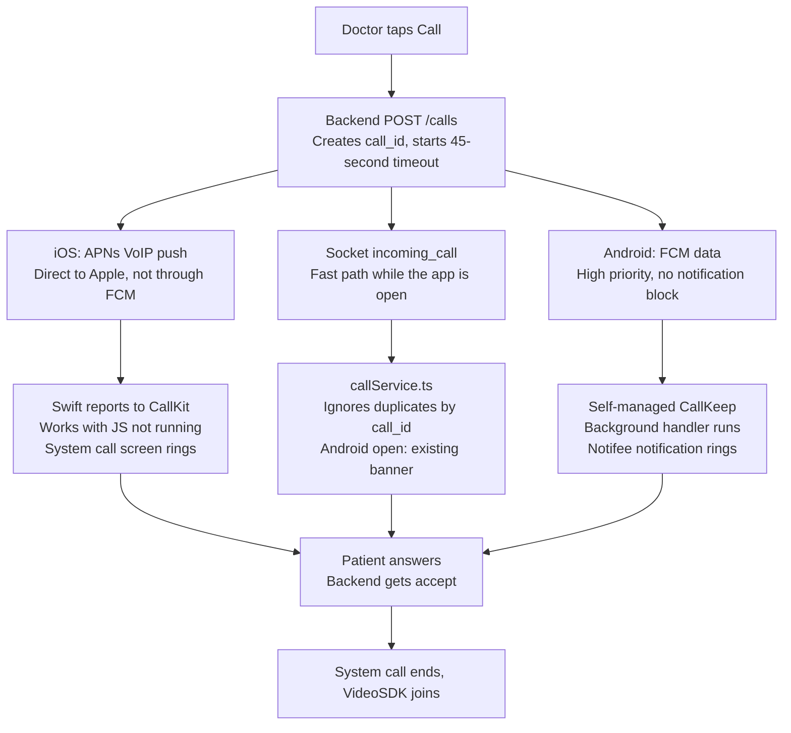
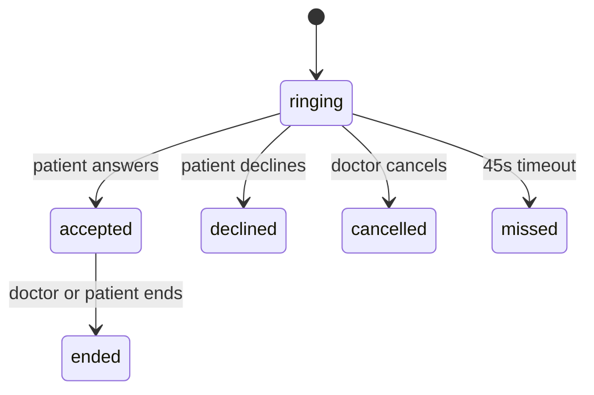

# PredCare Incoming Call Ringing Plan (react-native-callkeep)

**Status:** plan only, no code changed yet.
**Docs checked on:** 2026-11-02.

## Overview

When a doctor starts a consultation, the patient's phone rings like a normal phone call, even if the app is closed or the phone is locked. Today it only rings if the app is open and the socket is connected.

`react-native-callkeep` does only one part of this: it shows the system call screen and reports Answer and Decline. It can't wake a closed app, so the backend has to do that with a push:

| Part | iOS | Android |
| --- | --- | --- |
| Wakes the phone | VoIP push (PushKit), sent **directly to APNs** | High-priority, data-only FCM message |
| Shows the ring | CallKit, reported from native Swift | Self-managed Telecom call + full-screen Notifee notification |
| Extra package | `react-native-voip-push-notification` | None |
| Token the backend needs | VoIP token (new) | FCM token (already collected) |

**FCM can't send a VoIP push.** The backend needs a new direct connection to APNs for iOS calls. This is the largest backend item in the plan.

The socket stays as the fast path while the app is open. Socket and push both use the same `call_id`, so a call that arrives twice rings once.



A decline or no answer follows the same paths in reverse: the backend stops the ring on every device and tells the doctor.

## What exists today

The app already has the socket call flow, Firebase push and the join logic, so most of this plan connects existing parts. These findings shape the design:

| Where | What it does today | What must change |
| --- | --- | --- |
| `SocketListeners.tsx` | Shows the banner on `incoming_call` and hides it on `incoming_call_cancelled` | Send both events through the new call service |
| `GlobalIncomingCallBanner.tsx` | Holds the whole join flow inside the component | Move it to a function that can run from a CallKeep event |
| `IncomingCallBanner.tsx` | The close button only hides the banner, so the doctor is never told | Decline must call the backend |
| `useIncomingCallStore.ts` | Falls back to the name `Dr. Sahil Mallick` | Remove it, or a real caller name could be wrong on the ring screen |
| `useDeviceInfo.ts`, `LoginScreen`, `RegisterScreen` | The FCM token reaches the backend only at login and register | Add a device endpoint, or a refreshed token never reaches the backend and calls stop ringing |
| `pushToken.ts` | `onTokenRefresh` saves the new token only on the phone | Also send it to the new endpoint |
| `useAuthStore.ts` `logout` | Clears local data but doesn't remove the device from the backend | Remove the device, or a logged-out phone keeps ringing |
| `pushSetup.ts` | The background handler only logs messages | Add call routing for Android |
| `notificationDispatcher.ts` | Handles only `EventType.PRESS` | Add `ACTION_PRESS` for the Answer and Decline buttons |
| `AppDelegate.swift` | Starts React from `SceneDelegate` | A closed app woken by PushKit may have no JS running, so CallKit must be reported from native code |
| `useAndroidCallForegroundService.ts` | Runs a Notifee camera and microphone service during calls | Keep it, and don't turn on CallKeep's own foreground service |

Already in place, so no change is needed:

- The `voip` and `audio` background modes in `Info.plist`
- Push entitlement and dynamic frameworks in the `Podfile`
- `res/raw/ringtone.mp3` on Android and `ringtone.mp3` in the iOS folder
- `POST_NOTIFICATIONS`, camera and microphone permissions
- `INCOMING_VIDEO_CALL` in `NotificationEventActions`

The app runs React Native 0.87.1 with New Architecture on, and CallKeep's README lists it as tested with 0.87 and New Architecture. `npm view` shows version 4.6.1.

## Files and folders

All new call logic goes in one folder, `src/services/calls/`. Existing files only get small changes that connect to it. `A` = add, `M` = modify.

```text
predcarepatient/
├── package.json                                   M  react-native-callkeep, react-native-voip-push-notification
├── index.js                                       M  register call handling at startup
├── App.tsx                                        M  start CallKeep listeners
├── ios/predcarepatient/
│   ├── AppDelegate.swift                          M  CallKit setup, starts PushKit
│   ├── AppDelegate+PushKit.swift                  A  PushKit delegate, reports to CallKit
│   ├── CallResponder.swift                        A  CXCallObserver, sends answer/decline when JS isn't running
│   ├── predcarepatient-Bridging-Header.h          M  voip-push header, if it can't be imported as a module
│   └── Info.plist                                 no change (voip, audio already set)
├── android/app/src/main/
│   └── AndroidManifest.xml                        M  VoiceConnectionService, permissions
└── src/
    ├── services/
    │   ├── calls/                                 A  new folder
    │   │   ├── call.types.ts                      A  payload types, status values
    │   │   ├── callPayload.ts                     A  validates push and socket payloads
    │   │   ├── callApi.ts                         A  accept, decline, delivered
    │   │   ├── callKeepSetup.ts                   A  setup and event listeners
    │   │   ├── callService.ts                     A  one path for ring, answer, decline, end
    │   │   ├── androidRing.ts                     A  Notifee ring notification
    │   │   └── joinIncomingCall.ts                A  join flow moved out of the banner
    │   ├── api/endpoints.ts                       M  calls and devices routes
    │   └── notifications/
    │       ├── notification.core.ts               M  incoming_call channel
    │       ├── notificationDispatcher.ts          M  Answer and Decline buttons
    │       └── push/
    │           ├── pushSetup.ts                   M  send call pushes to callService
    │           ├── pushToken.ts                   M  send refreshed token to backend
    │           ├── deviceSync.ts                  A  register and remove the device
    │           └── voipToken.ts                   A  iOS VoIP token
    ├── components/commons/
    │   ├── Sockets/SocketListeners.tsx            M  send events to callService
    │   └── IncomingCallBanner/
    │       ├── GlobalIncomingCallBanner.tsx       M  uses joinIncomingCall, Android only
    │       └── IncomingCallBanner.tsx             M  close button declines the call
    ├── Features/SplashScreen/SplashScreen.tsx     M  join an answered call after login check
    ├── hooks/commons/useDeviceInfo.ts             M  add voip_token, apns_env
    ├── lib/common/asyncStorage.ts                 M  VOIP_TOKEN key
    └── zustand/stores/
        ├── useIncomingCallStore.ts                M  call_id, pending answer, remove default name
        └── useAuthStore.ts                        M  remove device on logout
```

## Shared JS code

Every ring source (socket, FCM, VoIP event) goes through `callService.ts`, which ignores duplicates by `call_id`.

**CallKeep is used for ringing only.** After the patient answers, the app ends the system call and joins through the existing VideoSDK flow. VideoSDK keeps control of audio, the Notifee service and PiP, so the working call screen doesn't change.

### Install

```bash
npm i react-native-callkeep react-native-voip-push-notification
cd ios && pod install
```

### `src/services/calls/call.types.ts`

```ts
export type IncomingCall = {
  call_id: string;        // UUID v4, also used as the CallKit UUID
  appointment_id: string;
  meeting_id: string;
  caller_name: string;
  call_type: string;
  expires_at: string;     // epoch seconds, kept as a string because FCM data values are strings
  call_token: string;     // short-lived, only allows answering this call
  respond_url: string;
};

export type CallPushType = 'call_incoming' | 'call_cancel';
export type CallResponse = 'delivered' | 'accept' | 'decline';
```

### `src/services/calls/callKeepSetup.ts`

```ts
import { Platform } from 'react-native';
import RNCallKeep from 'react-native-callkeep';
import { answerCall, declineCall, rememberCall } from './callService';

let setupDone: Promise<unknown> | null = null;

// iOS is set up in AppDelegate, so only Android does it here. Also runs from the FCM background handler.
export const ensureCallKeep = () => {
  if (Platform.OS !== 'android') return Promise.resolve();
  setupDone ??= RNCallKeep.setup({
    ios: { appName: 'PRED Care' },
    android: {
      alertTitle: 'Permission required',
      alertDescription: 'PRED Care needs this to ring for doctor calls',
      cancelButton: 'Cancel',
      okButton: 'OK',
      selfManaged: true,
      // The ring must continue if the background JS instance stops.
      endCallsWhenReactNativeStops: false,
    },
  });
  return setupDone;
};

const replayEvent = ({ name, data }: { name: string; data: any }) => {
  if (name === 'RNCallKeepDidDisplayIncomingCall') rememberCall(data.payload);
  if (name === 'RNCallKeepPerformAnswerCallAction') answerCall(data.callUUID);
  if (name === 'RNCallKeepPerformEndCallAction') declineCall(data.callUUID);
};

export const startCallKeepListeners = async () => {
  await ensureCallKeep();
  RNCallKeep.addEventListener('didDisplayIncomingCall', e => rememberCall(e.payload));
  RNCallKeep.addEventListener('answerCall', e => answerCall(e.callUUID));
  RNCallKeep.addEventListener('endCall', e => declineCall(e.callUUID));

  // Actions the patient took before JS was running. Splash waits for this.
  (await RNCallKeep.getInitialEvents()).forEach(replayEvent);
  RNCallKeep.clearInitialEvents();
};
```

### `src/services/calls/callService.ts`

```ts
import { AppState, Platform } from 'react-native';
import RNCallKeep, { CONSTANTS } from 'react-native-callkeep';
import { navigationRef } from '../../navigation/navigationRef';
import { AppRoute } from '../../route';
import { useIncomingCallStore } from '../../zustand/stores/useIncomingCallStore';
import { useMeetingStore } from '../../zustand/stores/useMeetingStore';
import { showAndroidRing, stopAndroidRing } from './androidRing';
import { respondToCall, getCall } from './callApi';
import type { IncomingCall } from './call.types';
import { ensureCallKeep } from './callKeepSetup';
import { joinIncomingCall } from './joinIncomingCall';

const calls = new Map<string, IncomingCall>();
const finished = new Set<string>();
const id = (value: string) => value.toLowerCase(); // iOS can report the UUID in upper case

const isExpired = (call: IncomingCall) =>
  Date.now() / 1000 > Number(call.expires_at) + 30; // 30s allowance for a wrong phone clock

export const rememberCall = (call?: IncomingCall) => {
  if (call?.call_id) calls.set(id(call.call_id), call);
};

export const ringIncomingCall = async (call: IncomingCall) => {
  const callId = id(call.call_id);
  if (calls.has(callId) || finished.has(callId) || isExpired(call)) return;
  if (useMeetingStore.getState().callInfo?.meetingId) return;

  rememberCall(call);
  respondToCall(call, 'delivered');
  await ensureCallKeep();
  RNCallKeep.displayIncomingCall(callId, 'PRED Care', call.caller_name, 'generic', true);

  if (Platform.OS === 'android') {
    if (AppState.currentState === 'active') {
      useIncomingCallStore.getState().showCallBanner(call);
    } else {
      await showAndroidRing(call);
    }
  }
};

// Clears the ring everywhere. Doesn't fire CallKeep's endCall event.
export const stopRinging = async (callId: string, reason: number) => {
  const key = id(callId);
  finished.add(key);
  RNCallKeep.reportEndCallWithUUID(key, reason);
  useIncomingCallStore.getState().hideCallBanner();
  if (Platform.OS === 'android') await stopAndroidRing(key);
};

export const cancelCall = async (callId: string) =>
  stopRinging(callId, CONSTANTS.END_CALL_REASONS.REMOTE_ENDED);

export const declineCall = async (callId: string, known?: IncomingCall) => {
  const key = id(callId);
  if (finished.has(key)) return;
  const call = known ?? calls.get(key);
  await stopRinging(key, CONSTANTS.END_CALL_REASONS.REMOTE_ENDED);
  if (call) await respondToCall(call, 'decline');
};

export const answerCall = async (callId: string, known?: IncomingCall) => {
  const key = id(callId);
  if (finished.has(key)) return;
  finished.add(key);
  // A cold start can miss the display event, so ask the backend as a fallback.
  const call = known ?? calls.get(key) ?? (await getCall(key));
  if (!call) return;
  await respondToCall(call, 'accept');

  const startJoin = async () => {
    await stopRinging(key, CONSTANTS.END_CALL_REASONS.REMOTE_ENDED);
    const route = navigationRef.isReady() ? navigationRef.getCurrentRoute()?.name : undefined;
    if (!route || route === AppRoute.SPLASH) {
      useIncomingCallStore.getState().setPendingAnswer(call);
    } else {
      await joinIncomingCall(call.appointment_id, call.caller_name);
    }
  };

  if (AppState.currentState === 'active') return startJoin();

  // Answered on a locked iPhone: the camera can't start until the app is open.
  const sub = AppState.addEventListener('change', state => {
    if (state === 'active') {
      sub.remove();
      startJoin();
    }
  });
};
```

### `src/services/calls/joinIncomingCall.ts`

This is the `handleJoin` body from `GlobalIncomingCallBanner.tsx`, moved as is, with these three changes:

- It takes `appointmentId` and `doctorName` as arguments.
- It reads stores with `useLoadingStore.getState()` and `useMeetingStore.getState()`.
- It needs a permission check that isn't a hook, because `useDevicePermissions` is one. Export a plain `requestCallPermissions()` from that file and have the hook use it too.

The banner then becomes `onJoin={() => answerCall(callId)}`, so a banner join also tells the backend.

### Small changes to existing files

`useIncomingCallStore.ts`: add `callId` and `pendingAnswer`, remove `DEFAULT_DOCTOR_NAME`.

```ts
showCallBanner: call => set({
  visible: true,
  callId: call.call_id,
  doctorName: call.caller_name || 'Your doctor',
  callType: call.call_type || 'Incoming Video Call...',
  appointmentId: call.appointment_id,
  meetingId: call.meeting_id,
}),
pendingAnswer: null,
setPendingAnswer: call => set({ pendingAnswer: call }),
consumePendingAnswer: () => {
  const call = get().pendingAnswer;
  set({ pendingAnswer: null });
  return call;
},
```

`SocketListeners.tsx`: replace the two handler bodies. Old events without `call_id` keep using the banner until the backend change is live.

```ts
const handleIncomingCall = (payload: IncomingCallSocketPayload) => {
  if (payload.call_id) return ringIncomingCall(toIncomingCall(payload));
  // ...existing showCallBanner path
};
const handleCallCancelled = (payload: { appointmentId: string; call_id?: string }) => {
  if (payload.call_id) return cancelCall(payload.call_id);
  // ...existing hideCallBanner path
};
```

`pushSetup.ts`: check for call messages first, on Android only. On iOS the call arrives by VoIP push, not FCM.

```ts
export const handleCallMessage = async (data?: Record<string, unknown>) => {
  if (data?.type === 'call_incoming') await ringIncomingCall(data as IncomingCall);
  else if (data?.type === 'call_cancel') await cancelCall(String(data.call_id));
  else return false;
  return true;
};

setBackgroundMessageHandler(getMessaging(), async message => {
  await handleCallMessage(message.data);
});

const stopMessages = onMessage(getMessaging(), async message => {
  if (await handleCallMessage(message.data)) return;
  return displayPush(message);
});
```

`notificationDispatcher.ts`: add this at the top of `routeNotificationPress`, before the `PRESS` check. Decline runs in the background and Answer opens the app.

```ts
const call = detail.notification?.data;
if (call?.type === 'call_incoming') {
  const action = detail.pressAction?.id;
  if (action === 'call_answer') await answerCall(String(call.call_id), call as IncomingCall);
  if (action === 'call_decline') await declineCall(String(call.call_id), call as IncomingCall);
  return;
}
```

The `PRESS` check currently drops `ACTION_PRESS`, and the cold-start replay passes `EventType.PRESS`, so this block has to come first to handle both.

`SplashScreen.tsx`: wait for the replayed events, then join after the home screen opens.

```ts
await processInitialNotification();
await startCallKeepListeners();   // once only, App.tsx skips it if this already ran
const pendingCall = useIncomingCallStore.getState().consumePendingAnswer();
// ...inside the verified patient branch, after resetToMainTabs:
if (pendingCall) joinIncomingCall(pendingCall.appointment_id, pendingCall.caller_name);
```

`pushToken.ts` and `deviceSync.ts`: send tokens to the backend whenever they change. `getDeviceInfo` must be exported from `useDeviceInfo.ts`.

```ts
export const syncDevice = async () => {
  if (!(await getItem(STORAGE_KEYS.AUTH_TOKEN))) return;
  await axiosInstance.put(endpoints.devices.upsert, await getDeviceInfo());
};

export const removeDevice = async () => {
  const deviceId = await getItem(STORAGE_KEYS.DEVICE_ID);
  if (deviceId) await axiosInstance.delete(endpoints.devices.remove(deviceId)).catch(() => {});
};
```

Call `syncDevice()` after login, after Splash loads the profile, on `onTokenRefresh` and on the VoIP `register` event. Call `removeDevice()` at the start of `logout`, because the auth token is cleared right after.

## iOS plan

On iOS, native Swift has to report every VoIP push to CallKit before JS can run. Apple's rule, [quoted in the voip-push README](https://github.com/react-native-webrtc/react-native-voip-push-notification), is that iOS 13+ terminates an app that fails to report one.

### Apple and Xcode setup

- [ ] Apple Developer: confirm the existing `.p8` APNs key covers Sandbox and Production, then give the backend the Key ID, the Team ID (`88X8RN3KC7`) and the key.
- [ ] Xcode: confirm **Voice over IP** and **Audio, AirPlay, and Picture in Picture** are ticked. `Info.plist` already has both.
- [ ] Xcode: add `AppDelegate+PushKit.swift` and `CallResponder.swift` to the `predcarepatient` target.
- [ ] Test on a physical iPhone, because the Simulator has no CallKit service.

### `ios/predcarepatient/AppDelegate.swift`

Add these after `FirebaseApp.configure()` and before the React factory is created. Add `import RNCallKeep` and `import RNVoipPushNotification` at the top of the file.

```swift
RNCallKeep.setup([
  "appName": "PRED Care",
  "handleType": "generic",
  "supportsVideo": true,
  "includesCallsInRecents": false,  // keeps doctor calls out of the Phone app history
  "maximumCallGroups": "1",
  "maximumCallsPerCallGroup": "1",
  "ringtoneSound": "ringtone.mp3",
])
CallResponder.shared.start()
RNVoipPushNotificationManager.voipRegistration()
```

`voipRegistration()` makes the app delegate the PushKit delegate, so the delegate methods have to be on `AppDelegate`.

### `ios/predcarepatient/AppDelegate+PushKit.swift`

```swift
import PushKit
import RNCallKeep
import RNVoipPushNotification

extension AppDelegate: PKPushRegistryDelegate {
  func pushRegistry(_ registry: PKPushRegistry,
                    didUpdate credentials: PKPushCredentials,
                    for type: PKPushType) {
    RNVoipPushNotificationManager.didUpdate(credentials, forType: type.rawValue)
  }

  func pushRegistry(_ registry: PKPushRegistry,
                    didReceiveIncomingPushWith payload: PKPushPayload,
                    for type: PKPushType,
                    completion: @escaping () -> Void) {
    let data = payload.dictionaryPayload
    let uuid = (data["call_id"] as? String) ?? UUID().uuidString
    let name = (data["caller_name"] as? String) ?? "Your doctor"
    let isCancel = (data["type"] as? String) == "call_cancel"
    let expiresAt = Double(data["expires_at"] as? String ?? "") ?? 0
    let secondsLeft = expiresAt - Date().timeIntervalSince1970

    RNVoipPushNotificationManager.didReceiveIncomingPush(with: payload, forType: type.rawValue)
    if !isCancel { CallResponder.shared.remember(uuid: uuid, data: data) }

    // Every VoIP push must be reported, even a cancel or an expired call.
    // A cancel reuses the UUID, so CallKit treats it as the same call.
    RNCallKeep.reportNewIncomingCall(
      uuid, handle: "PRED Care", handleType: "generic", hasVideo: true,
      localizedCallerName: name, supportsHolding: false, supportsDTMF: false,
      supportsGrouping: false, supportsUngrouping: false, fromPushKit: true,
      payload: data as? [String: Any]
    ) {
      if isCancel || secondsLeft < -30 {
        RNCallKeep.endCall(withUUID: uuid, reason: 2)  // REMOTE_ENDED
      } else {
        // Stops the ring if the phone never receives the cancel.
        DispatchQueue.main.asyncAfter(deadline: .now() + max(secondsLeft, 5)) {
          CallResponder.shared.endIfStillRinging(uuid: uuid)
        }
      }
      completion()
    }
  }
}
```

The PushKit, CallKeep and voip-push method names above are Swift translations of Objective-C APIs. Confirm them at the first compile. If `import RNVoipPushNotification` fails, add the header to `predcarepatient-Bridging-Header.h`.

### `ios/predcarepatient/CallResponder.swift`

This file solves a problem caused by the app's scene setup. When a closed app is woken in the background, JS may not be running because `SceneDelegate` starts React. A decline on the lock screen would then never reach the doctor. `CXCallObserver` sees the outcome in native code and calls the backend directly.

```swift
import CallKit
import RNCallKeep
import UIKit

final class CallResponder: NSObject, CXCallObserverDelegate {
  static let shared = CallResponder()
  private let observer = CXCallObserver()
  private var pending: [UUID: (url: String, token: String)] = [:]
  private var answered = Set<UUID>()

  func start() { observer.setDelegate(self, queue: .main) }

  func remember(uuid: String, data: [AnyHashable: Any]) {
    guard let id = UUID(uuidString: uuid),
          let url = data["respond_url"] as? String,
          let token = data["call_token"] as? String else { return }
    pending[id] = (url, token)
  }

  func endIfStillRinging(uuid: String) {
    guard let id = UUID(uuidString: uuid), pending[id] != nil, !answered.contains(id) else { return }
    RNCallKeep.endCall(withUUID: uuid, reason: 6)  // MISSED
  }

  func callObserver(_ callObserver: CXCallObserver, callChanged call: CXCall) {
    guard let info = pending[call.uuid] else { return }
    if call.hasEnded {
      if !answered.contains(call.uuid) { send("decline", info) }
      pending[call.uuid] = nil
      answered.remove(call.uuid)
    } else if call.hasConnected, answered.insert(call.uuid).inserted {
      send("accept", info)
    }
  }

  private func send(_ action: String, _ info: (url: String, token: String)) {
    guard let url = URL(string: info.url) else { return }
    var request = URLRequest(url: url)
    request.httpMethod = "POST"
    request.setValue("application/json", forHTTPHeaderField: "Content-Type")
    request.httpBody = try? JSONSerialization.data(
      withJSONObject: ["action": action, "call_token": info.token])

    // The app can be suspended as soon as the call ends.
    var task = UIBackgroundTaskIdentifier.invalid
    task = UIApplication.shared.beginBackgroundTask { UIApplication.shared.endBackgroundTask(task) }
    URLSession.shared.dataTask(with: request) { _, _, _ in
      UIApplication.shared.endBackgroundTask(task)
    }.resume()
  }
}
```

A remote cancel or the timeout also ends the call and sends `decline`. The backend ignores it because the call is no longer ringing.

### VoIP token: `src/services/notifications/push/voipToken.ts`

```ts
import { Platform } from 'react-native';
import VoipPushNotification from 'react-native-voip-push-notification';
import { setItem, STORAGE_KEYS } from '../../../lib/common/asyncStorage';
import { syncDevice } from './deviceSync';

export const startVoipToken = () => {
  if (Platform.OS !== 'ios') return;
  VoipPushNotification.addEventListener('register', async token => {
    await setItem(STORAGE_KEYS.VOIP_TOKEN, token);
    await syncDevice();
  });
  VoipPushNotification.registerVoipToken(); // sends the cached token again
};
```

Add `voip_token` and `apns_env` to the iOS branch of `getDeviceInfo`. Set `apns_env` to `__DEV__ ? 'sandbox' : 'production'`. A release build installed from Xcode with development signing still uses sandbox, so test production through TestFlight. Keep `VOIP_TOKEN` through logout by adding it to the `clearStorageExcept` list, as `FCM_TOKEN` is.

### How answering works on iPhone

| Phone state | Patient sees | What happens |
| --- | --- | --- |
| App open | CallKit call UI | JS gets `answerCall` and joins straight away |
| Background, unlocked | CallKit banner | Answer should open the app for a video call, then join |
| Locked | Full CallKit lock screen | Backend gets `accept` from native code, and the join starts once the patient unlocks and opens the app |
| Closed and locked | Full CallKit lock screen | Same, and JS replays the answer from `getInitialEvents()` at Splash |

The existing banner doesn't run on iOS, because a VoIP push always shows CallKit too and the patient would get two ring screens.

## Android plan

Android uses CallKeep's **self-managed** mode, and the ring itself is a Notifee notification with Answer and Decline buttons.

I chose self-managed over managed mode for three reasons:

- It uses `MANAGE_OWN_CALLS` rather than phone permissions such as `CALL_PHONE`.
- The patient doesn't have to enable a phone account in system settings.
- CallKeep's [self-managed guide](https://github.com/react-native-webrtc/react-native-callkeep/blob/master/docs/guides/android-self-managed.md) leaves the incoming UI to the app, so the existing banner and Notifee can be reused.

### `android/app/src/main/AndroidManifest.xml`

```xml
<!-- CallKeep's own manifest adds these two. Self-managed calls shouldn't need them. -->
<uses-permission android:name="android.permission.CALL_PHONE" tools:node="remove" />
<uses-permission android:name="android.permission.READ_PHONE_NUMBERS" tools:node="remove" />

<uses-permission android:name="android.permission.FOREGROUND_SERVICE_PHONE_CALL" />
<uses-permission android:name="android.permission.USE_FULL_SCREEN_INTENT" />

<application>
  <!-- Add beside the existing services -->
  <service
      android:name="io.wazo.callkeep.VoiceConnectionService"
      android:label="PRED Care"
      android:permission="android.permission.BIND_TELECOM_CONNECTION_SERVICE"
      android:foregroundServiceType="phoneCall|microphone|camera"
      android:exported="true">
    <intent-filter>
      <action android:name="android.telecom.ConnectionService" />
    </intent-filter>
  </service>
</application>
```

No changes are needed in `MainActivity.kt` or `MainApplication.kt`, because [autolinking handles the library](https://github.com/react-native-webrtc/react-native-callkeep/blob/master/docs/android-installation.md). Don't pass CallKeep's `foregroundService` option either, because `useAndroidCallForegroundService.ts` already runs the call service.

On the first device test, confirm that `setup()` doesn't fail or prompt without the two removed permissions. If it needs them, keep them and update the Play declarations.

### `src/services/calls/androidRing.ts`

```ts
import notifee, {
  AndroidCategory,
  AndroidImportance,
  AndroidVisibility,
} from '@notifee/react-native';
import type { IncomingCall } from './call.types';

const CHANNEL_ID = 'incoming_call';

export const showAndroidRing = async (call: IncomingCall) => {
  // Created here too: in the background, NotificationEventListener hasn't mounted.
  await notifee.createChannel({
    id: CHANNEL_ID,
    name: 'Incoming doctor calls',
    importance: AndroidImportance.HIGH,
    visibility: AndroidVisibility.PUBLIC,
    sound: 'ringtone', // res/raw/ringtone.mp3
    vibration: true,
    vibrationPattern: [300, 1000, 500, 1000],
  });

  const msLeft = Number(call.expires_at) * 1000 - Date.now();

  await notifee.displayNotification({
    id: call.call_id,
    title: call.caller_name,
    body: 'Incoming video consultation',
    data: { ...call, type: 'call_incoming' },
    android: {
      channelId: CHANNEL_ID,
      smallIcon: 'ic_launcher',
      category: AndroidCategory.CALL,
      importance: AndroidImportance.HIGH,
      visibility: AndroidVisibility.PUBLIC,
      ongoing: true,
      autoCancel: false,
      loopSound: true,
      timeoutAfter: Math.max(msLeft, 5000), // stops the ring if the cancel never arrives
      pressAction: { id: 'default', launchActivity: 'default' },
      fullScreenAction: { id: 'default' },
      actions: [
        { title: 'Decline', pressAction: { id: 'call_decline' } },
        { title: 'Answer', pressAction: { id: 'call_answer', launchActivity: 'default' } },
      ],
    },
  });
};

export const stopAndroidRing = (callId: string) => notifee.cancelNotification(callId);
```

Android won't change a channel's sound or importance after it's created, so get these values right before the first release.

### How each app state rings

| Phone state | Who wakes the app | Patient sees | Answer | Decline |
| --- | --- | --- | --- | --- |
| App open | Socket, then FCM ignored as a duplicate | Existing banner, moved to `callService` | Joins directly | `declineCall` |
| Background | FCM data message | Heads-up notification that rings | Opens the app, then joins | Handled in the background |
| Closed (swiped away) | FCM runs the background handler | Same | Opens the app through Splash, then joins | Handled in the background |
| Locked | FCM | Ringing notification on the lock screen, screen wakes | Patient unlocks, then the app joins | Handled without unlocking |

### Lock screen decision

The first version shows the call as a ringing lock-screen notification and doesn't open the app over the lock screen. [Notifee's docs](https://notifee.app/react-native/docs/android/behaviour) would put `showWhenLocked` on `MainActivity` for a full-screen call, but that lets anyone holding the phone open a patient's health app without unlocking it. That activity also carries the sensitive PiP logic.

If you want a WhatsApp-style full-screen call later, add a small native `IncomingCallActivity` that shows only the doctor's name and the two buttons. It can go in without changing the rest of this plan.

### Permissions to check

Call these checks when the patient enters the app, not at ring time:

- **Notifications (Android 13+):** if denied, nothing rings in the background. Show a clear prompt on the appointment screen.
- **Full-screen intent (Android 14+):** [Android limits this to calling and alarm apps](https://developer.android.com/about/versions/14/behavior-changes-14), and users can turn it off. The ring falls back to a heads-up notification.
- **Battery optimisation:** some phones restrict background apps. An app force-stopped from settings receives nothing until it's opened again, so the doctor needs a clear no-answer state.

### Play Console

- Complete the full-screen intent declaration, with video consultation calling as the reason.
- Complete the `phoneCall` foreground service declaration, and include a demo video of the call flow if asked.
- Keep `camera` and `microphone` declared, because they're already used for calls.

## Backend plan

The backend owns each call's status and decides when the phone stops ringing. Phones can miss messages, so a server timeout has to end every unanswered call. The backend repo wasn't available for this plan, so the code below is pseudocode and the route names are proposals.

### What the backend must do when a doctor calls

```text
startCall(doctor, appointment):
  check the doctor owns this appointment and the consultation window is open
  if a call for this appointment is already ringing: return that call
  if the patient is in another connected call: return 409 patient_busy

  call = create call_sessions row (status = ringing, expires_at = now + 45s)
  token = sign { call_id, patient_id } with a 5 minute expiry

  emit socket incoming_call to the patient room      // fast path
  for each active patient device:
    ios with voip_token -> send VoIP push through APNs
    android             -> send data-only FCM
    older app version   -> send today's notification push

  schedule timeoutCall(call.id) in 45s               // background job
  return call to the doctor app
```

Send pushes through a queue, so one slow device doesn't delay the rest. The socket and push go out together, because the backend can't tell whether a connected socket belongs to a phone in use.

### Database

`call_sessions` (new):

| Column | Type | Notes |
| --- | --- | --- |
| `id` | UUID v4, primary key | The `call_id`; must be a UUID because CallKit requires one |
| `appointment_id` | foreign key | Only one ringing call per appointment |
| `doctor_id`, `patient_id` | foreign keys |  |
| `meeting_id` | string | VideoSDK meeting |
| `status` | enum | `ringing`, `accepted`, `declined`, `missed`, `cancelled`, `ended` |
| `end_reason` | string, nullable | `answered_elsewhere`, `doctor_hung_up` and so on |
| `answered_device_id` | string, nullable |  |
| `expires_at`, `accepted_at`, `ended_at` | timestamp |  |

`patient_devices` (new, or extend the table that stores `fcm_token` from login):

| Column | Type | Notes |
| --- | --- | --- |
| `patient_id`, `device_id` | unique together | `device_id` comes from `useDeviceInfo.ts` |
| `platform` | string | `ios` or `android` |
| `fcm_token` | string, nullable |  |
| `voip_token` | string, nullable | iOS only, not the same as the FCM token |
| `apns_env` | string, nullable | `sandbox` or `production` |
| `app_version`, `os_version`, `device_name` | string | `app_version` decides between old and new push |
| `last_seen_at`, `revoked_at` | timestamp | Skip revoked devices |

When a device registers, remove the same token from any other patient's row. On a shared phone, the previous patient's doctor must not ring it.

### API routes

| Method and route | Called by | What it does |
| --- | --- | --- |
| `PUT /devices` | Patient app | Saves `getDeviceInfo()` plus `voip_token` and `apns_env` |
| `DELETE /devices/{device_id}` | Patient app, on logout | Sets `revoked_at` |
| `POST /calls` | Doctor app | Runs `startCall`; replaces whatever starts the ring today |
| `POST /calls/{id}/cancel` | Doctor app | Doctor hangs up while ringing |
| `GET /calls/{id}` | Patient app | Fallback call details after a cold start |
| `POST /calls/{id}/respond` | Patient app or iOS native code | Body `{ action, call_token }`; action is `delivered`, `accept` or `decline` |
| `POST /calls/{id}/end` | Doctor app | Ends the session |

`/respond` authenticates with `call_token`, not the login token, because iOS native code doesn't have a login token. It must be safe to call twice: an action on a call that's no longer ringing does nothing and returns `200` with the current status. The existing appointment token endpoint stays the only way to get a meeting token, so `call_token` can't join a meeting.

### Push content

The same fields go in the socket event, FCM and APNs. Keep the old socket names too, so older apps keep working. Include only what the ring screen needs, because this text can show on a lock screen: no diagnosis, reason for visit or meeting token.

```json
{
  "type": "call_incoming",
  "call_id": "6f1d2a58-9c3e-4b7a-8f10-2d4c6e8a1b35",
  "appointment_id": "1042",
  "meeting_id": "abcd-efgh-ijkl",
  "caller_name": "Dr. Example Name",
  "call_type": "video",
  "expires_at": "1793620845",
  "call_token": "<signed short-lived token>",
  "respond_url": "https://api.example.in/api/v1/calls/6f1d2a58-9c3e-4b7a-8f10-2d4c6e8a1b35/respond"
}
```

Keep all values as strings, because FCM data only allows strings.

### iOS: direct to APNs

Use an HTTP/2 APNs library for your stack, with the `.p8` key stored as a secret.

```text
POST https://api.push.apple.com/3/device/<voip_token>
(api.sandbox.push.apple.com when apns_env = sandbox)

authorization: bearer <ES256 JWT from the .p8 key>
apns-push-type: voip
apns-topic: com.predcarepatient.voip
apns-priority: 10
apns-expiration: <expires_at>

{ ...the JSON above }
```

| APNs response | Action |
| --- | --- |
| `200` | Done |
| `410 Unregistered` | Clear that `voip_token` |
| `400 BadDeviceToken` | Usually the wrong `apns_env`; log it, then clear the token if it fails again |
| `403` | Key or topic problem; alert the team |
| `429` or `5xx` | Retry once, only while the call is still ringing |

**Never send a VoIP push that isn't a call.** iOS requires each one to be reported to CallKit, so no reminders or other notifications through this route. Also stop sending today's alert push for `incoming_video_call` to iOS devices that have a `voip_token`, or the patient gets two alerts.

### Android: data-only FCM

```json
{
  "message": {
    "token": "<fcm_token>",
    "data": { "type": "call_incoming", "call_id": "..." },
    "android": { "priority": "high", "ttl": "45s" }
  }
}
```

There must be no `notification` block. With one, Android shows a normal notification in the background and the app's handler doesn't run, so nothing would ring.

High priority needs care. [FCM can lower it](https://firebase.google.com/docs/cloud-messaging/android-message-priority) when messages don't lead to a visible notification, and it judges this over 7 days per app install. So use high priority only for ring and cancel messages, and have a cancel show a "Missed call" notification when the patient didn't answer anywhere.

### Ending the ring

Every end sends `call_cancel` with the `call_id` on all three routes, except to the device that answered. iOS native code handles it too, and it's still reported to CallKit.

| Event | Status | Patient devices | Doctor app gets |
| --- | --- | --- | --- |
| Patient accepts | `accepted` | Others stop ringing, reason `answered_elsewhere` | `call_accepted` |
| Patient declines | `declined` | Others stop ringing | `call_declined` |
| Doctor cancels | `cancelled` | All stop, missed call shown | Nothing |
| 45 seconds pass | `missed` | All stop, missed call shown | `call_missed` |



The first response wins. Run the status change as an atomic update (`UPDATE ... WHERE status = 'ringing'`), so an accept and a timeout can't both succeed.

### Doctor app changes

- Start a call with `POST /calls` and keep the returned `call_id`.
- Show "Ringing", "Declined" and "No answer" from the new socket events.
- Let the doctor call again after a decline or no answer, which creates a new `call_id`.

### Monitoring

Log every step against `call_id`: pushes sent, the `delivered` response, the patient's answer and the final status. The gap between sent and `delivered` per platform shows where calls are failing, especially on Android phones with strict battery limits.

## Risks to test first

These items couldn't be confirmed from docs or code, so test them on real phones before building the rest. A failure here changes the design.

| Risk | Test | If it fails |
| --- | --- | --- |
| `react-native-voip-push-notification` doesn't state New Architecture support, and its README shows no Swift setup | Build it on 0.87.1 and receive a VoIP token | Write a small native module, following `src/native/NativePip.ts` |
| The Swift method names in the iOS code are translated from Objective-C | Compile `AppDelegate+PushKit.swift` | Correct them from the library headers |
| VideoSDK may lose the mic or audio right after CallKit ends | Answer through CallKit, end it, then join; check two-way audio | Wait for CallKeep's audio session to deactivate before opening tracks |
| Whether iOS opens the app on answer when the phone is unlocked | Answer from the banner in the background | Show a local notification that says "Tap to join" |
| Whether a closed iPhone connects the scene when the patient answers | Answer on the lock screen with the app closed | Keep the unlock-to-join flow, and test a CallKeep `didLoadWithEvents` listener as well |
| Android `setup()` without `CALL_PHONE` and `READ_PHONE_NUMBERS` | Self-managed call on Android 10, 13 and 15 | Keep those permissions and declare them on Play |

## Edge cases

| Case | Behaviour |
| --- | --- |
| Patient already in a consultation | Backend returns `patient_busy` and doesn't ring |
| Regular phone call in progress | iOS and Android show the call as waiting or a heads-up; the patient chooses |
| Socket and push both arrive | `call_id` check rings once |
| Accept arrives after the 45-second timeout | `/respond` returns `missed`, and the app shows "Call ended" with no join |
| Two phones on the same account | First answer wins, the other stops with `answered_elsewhere` |
| Patient logged out | Device removed on logout, so it doesn't ring |
| Logout request failed or app was uninstalled | Push may still arrive; `410` on iOS clears the token, and the join fails with no login |
| Camera or mic permission not granted | Asked after the app opens; if denied, the existing error toast shows and the ring has already stopped |
| Answer with email or policy step unfinished | Pending call is dropped and the setup screen opens |
| Doctor cancels during a patient's unlock | Join fails with "Call ended", and the backend marks it `cancelled` |
| Android ring when a cancel is lost | `timeoutAfter` removes the notification; the iOS native timer does the same job |

## Test checklist

Test each row with the socket on and off, on a physical iPhone from a TestFlight build and at least one Samsung and one Xiaomi or Oppo phone.

- [ ] App open: rings once; answer joins; decline tells the doctor
- [ ] Background: rings; answer joins; decline tells the doctor
- [ ] Closed: rings; answer goes through Splash and joins
- [ ] Locked: rings; decline works without unlocking; answer joins after unlock
- [ ] Doctor cancels while ringing: stops within a few seconds, missed call shows
- [ ] No answer for 45 seconds: stops on both sides
- [ ] Second phone on the same account stops when the first one answers
- [ ] Logout, then call: no ring
- [ ] Token refresh and reinstall: the next call still rings
- [ ] Video call afterwards: camera, mic, PiP and foreground service still work
- [ ] Old app version: still gets today's notification

## Rollout order

The backend can ship first without affecting the current app.

1. **Proof of concept (iOS and Android):** install both packages, then run the risk tests above using a test script that sends one push.
2. **Backend foundation:** add the tables, `PUT /devices`, `DELETE /devices` and token updates, then the APNs connection.
3. **Backend calls:** add `/calls` routes, `respond`, the 45-second timeout and socket events, behind a feature flag. Old apps keep today's flow.
4. **Shared JS:** add `src/services/calls/`, device sync and the moved join flow. The banner should still work on Android at this point.
5. **Android:** add the manifest changes, `androidRing.ts`, the FCM handler, notification buttons and a missed-call notification on `call_cancel`.
6. **iOS:** add the native files, the VoIP token and the cold-start replay.
7. **Doctor app:** add `POST /calls` and the ringing, declined and no-answer states.
8. **Release:** run the checklist, complete the Play declarations, then turn on the flag for internal users, followed by everyone.

## Open decisions

I've used these defaults in the plan. They can each change without affecting the design.

| Decision | Default used | When to change |
| --- | --- | --- |
| Ring duration | 45 seconds | Whatever the doctor workflow prefers |
| Android lock screen | Ringing notification, app not shown over the lock screen | If you want full-screen, add `IncomingCallActivity` |
| App Store regions | Remove the China storefront if the app is listed there, because Apple has restricted CallKit in China (from memory, confirm before submission) | Not relevant if the app is India-only |
| Doctor name on the lock screen | Shown, because the patient needs to know who's calling | If compliance requires it, use "PRED Care doctor" |

## Sources

Checked on 2026-11-02:

- [CallKeep README](https://github.com/react-native-webrtc/react-native-callkeep), with its [Android install](https://github.com/react-native-webrtc/react-native-callkeep/blob/master/docs/android-installation.md), [iOS install](https://github.com/react-native-webrtc/react-native-callkeep/blob/master/docs/ios-installation.md), [API](https://github.com/react-native-webrtc/react-native-callkeep/blob/master/docs/api.md), [events](https://github.com/react-native-webrtc/react-native-callkeep/blob/master/docs/events.md), [setup](https://github.com/react-native-webrtc/react-native-callkeep/blob/master/docs/setup.md) and [background calls](https://github.com/react-native-webrtc/react-native-callkeep/blob/master/docs/guides/background-calls.md) docs
- [react-native-voip-push-notification README](https://github.com/react-native-webrtc/react-native-voip-push-notification)
- [Notifee Android behaviour](https://notifee.app/react-native/docs/android/behaviour)
- [Android 14 behaviour changes](https://developer.android.com/about/versions/14/behavior-changes-14)
- [FCM message priority](https://firebase.google.com/docs/cloud-messaging/android-message-priority)

Apple's PushKit and APNs pages wouldn't load in the fetch tool. The APNs headers, hosts and response codes in this plan are from memory, so confirm them against [Sending notification requests to APNs](https://developer.apple.com/documentation/usernotifications/sending-notification-requests-to-apns) and [Handling notification responses from APNs](https://developer.apple.com/documentation/usernotifications/handling-notification-responses-from-apns). The FCM `ttl` field and the rule that a `notification` block skips the background handler are also from memory, so check them in the FCM docs.
