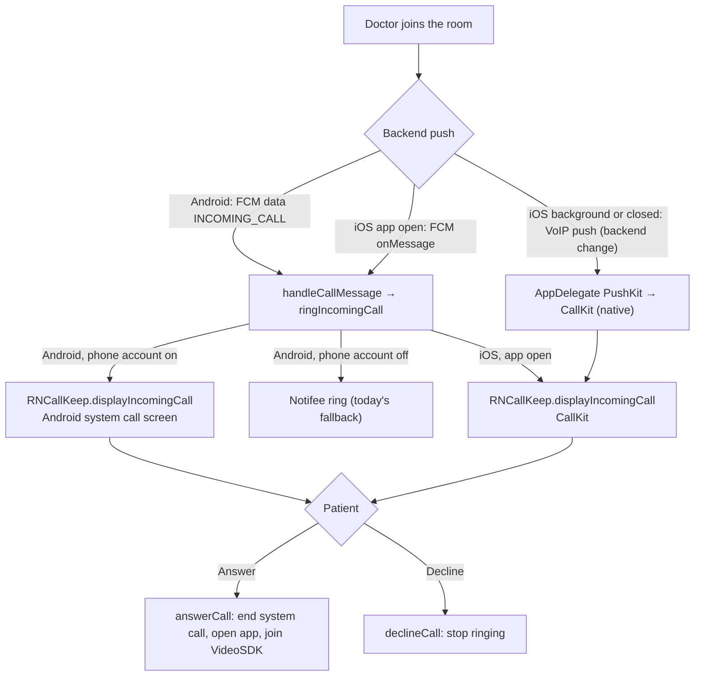

# Native Call Screen Plan with CallKeep (iOS and Android)

**Status:** implemented in the app on 2026-11-03. Not yet tested on devices. iOS background and closed still need the backend VoIP change below.
**Code:** `src/services/calls/` (`callKeepSetup.ts`, `callService.ts`, `callPermissionPrompt.ts`, `voipToken.ts`, `deviceSync.ts`), `ios/predcarepatient/AppDelegate.swift` and `AppDelegate+PushKit.swift`.
**Builds on:** [callkeepringingplan.md](./callkeepringingplan.md). Push ringing in `src/services/calls/` is already in the app.
**Goal:** every incoming doctor call shows the phone's own call screen through `react-native-callkeep`, whether the app is open, in the background or closed. No hand-made call screen and no in-app banner.
**Checked on:** 2026-11-03.

## What changes

| | Today | After this plan |
| --- | --- | --- |
| Android, app open | In-app banner | **Android's system incoming call screen** (like the reference picture) |
| Android, background, closed or locked | Notifee notification with Answer and Decline | **Same system call screen** |
| iOS, app open | In-app banner | **iPhone call screen (CallKit)** |
| iOS, background, closed or locked | System notification with ringtone | **iPhone call screen (CallKit)**, once the backend sends VoIP pushes |

Two switches make this possible:

1. **Android: CallKeep managed mode** (`selfManaged: false`). Android's Phone app then draws the incoming call screen. Self-managed mode, used today, has no system screen.
2. **iOS: `react-native-voip-push-notification` plus PushKit.** Only a VoIP push can wake a closed iPhone and show CallKit. You're right that it's missing.

## Things to know before building

- **Android permission step.** Managed mode needs the patient to grant phone permission and turn on a "PRED Care" calling account in system settings. CallKeep's `setup()` asks for both. Do this once, after login, with a short explanation screen. If the patient says no, the app falls back to today's Notifee ring, so calls still ring.
- **Android when the phone is in use.** If the patient is using another app, Android shows the system incoming call as a heads-up popup instead of full screen. That's how normal phone calls behave too.
- **iOS when the phone is unlocked.** iOS shows a CallKit call as a banner at the top when the phone is in use, unless the patient set Settings > Phone > Incoming Calls to Full Screen. That's normal iPhone behaviour.
- **iOS needs a backend change for background and closed.** The backend sends iOS a normal FCM alert today. CallKit in the background needs a VoIP push sent directly to APNs. Until the backend does that, iOS gets CallKit only when the app is open (from the FCM message in `onMessage`), and the current notification otherwise.
- **After Answer,** the app ends the system call and joins the VideoSDK meeting as it does today. The video call screen, PiP and foreground service don't change.

## Flow



## Files and folders

`A` = new file, `M` = small change, everything else stays.

```text
predcarepatient/
├── package.json                                  M  + react-native-voip-push-notification
├── index.js                                      M  register CallKeep listeners for background JS
├── android/app/src/main/AndroidManifest.xml      M  keep CALL_PHONE and READ_PHONE_NUMBERS
├── ios/predcarepatient/
│   ├── AppDelegate.swift                         M  CallKit setup, start PushKit
│   ├── AppDelegate+PushKit.swift                 A  VoIP push → CallKit
│   └── predcarepatient-Bridging-Header.h         M  only if the voip header can't be imported
└── src/
    ├── services/calls/
    │   ├── callKeepSetup.ts                      M  managed mode, permission step, background setup
    │   ├── callService.ts                        M  system call screen instead of banner / Notifee
    │   ├── callPermissionPrompt.ts               A  one-time explanation, then setup()
    │   └── voipToken.ts                          A  iOS VoIP token → backend
    ├── services/calls/deviceSync.ts              M  send voip_token
    └── Features/SplashScreen/SplashScreen.tsx    M  replay answers made before JS started
```

Not changed: `SocketListeners.tsx`, the banner components and `useIncomingCallStore.ts`. `androidRing.ts` stays as the fallback.

## Android

### 1. Manifest

Remove the two `tools:node="remove"` lines added for self-managed mode, because managed mode needs both permissions:

```xml
<!-- delete these two lines -->
<uses-permission android:name="android.permission.CALL_PHONE" tools:node="remove" />
<uses-permission android:name="android.permission.READ_PHONE_NUMBERS" tools:node="remove" />
```

Keep the `VoiceConnectionService` entry and `FOREGROUND_SERVICE_PHONE_CALL` as they are.

### 2. `callKeepSetup.ts`

```ts
const OPTIONS = {
  ios: {
    appName: 'PRED Care',
    supportsVideo: true,
    includesCallsInRecents: false,
    maximumCallGroups: '1',
    maximumCallsPerCallGroup: '1',
    ringtoneSound: 'ringtone.caf',
  },
  android: {
    alertTitle: 'Allow doctor calls',
    alertDescription: 'Turn on PRED Care calling so your doctor\'s video calls ring like a normal phone call.',
    cancelButton: 'Not now',
    okButton: 'Open settings',
    additionalPermissions: [],
    selfManaged: false, // managed: Android's Phone app shows the call screen
    endCallsWhenReactNativeStops: false,
    imageName: 'ic_launcher',
  },
};

// In the app, after login: shows the permission prompts and opens the calling-account settings.
export const setupCallKeepWithPrompt = () => RNCallKeep.setup(OPTIONS);

// In the FCM background handler: no prompts, because there's no screen to show them on.
export const ensureCallKeep = async () => {
  if (Platform.OS !== 'android') return;
  RNCallKeep.registerPhoneAccount(OPTIONS);
  RNCallKeep.registerAndroidEvents();
};

export const canShowSystemCall = async () =>
  Platform.OS === 'ios' || (await RNCallKeep.hasPhoneAccount());
```

### 3. `callPermissionPrompt.ts`

Show a short in-app message once after login: "Your doctor's calls will ring like a normal phone call. Allow PRED Care to manage calls." Then call `setupCallKeepWithPrompt()`. Remember with AsyncStorage that it was shown, and show it again from the appointment screen if the account is still off.

### 4. `callService.ts`: ring with the system screen

Replace the banner and Notifee branch in `ringIncomingCall`:

```ts
await ensureCallKeep();
if (await canShowSystemCall()) {
  // System screen in every app state: open, background, closed, locked.
  RNCallKeep.displayIncomingCall(call.callId, 'PRED Care', call.callerName, 'generic', true);
} else if (Platform.OS === 'android') {
  await showAndroidRing(call); // fallback when the patient hasn't turned the calling account on
}
```

`showBanner` stays in the file but isn't called.

### 5. Answer and Decline from the system screen

CallKeep's events become the main path. Register them in `index.js`, so they also work when the app was closed and only the background JS is running:

```ts
RNCallKeep.addEventListener('answerCall', ({ callUUID }) => answerCall(callUUID));
RNCallKeep.addEventListener('endCall', ({ callUUID }) => declineCall(callUUID));
```

`answerCall` adds three steps before the existing join:

```ts
RNCallKeep.backToForeground();                            // opens the app; asks for unlock if locked
RNCallKeep.reportEndCallWithUUID(callId, REMOTE_ENDED);   // closes the Phone app's in-call screen
// then the existing flow: pending answer at Splash, or joinIncomingCall
```

`backToForeground` already asks Android for an unlock on a locked phone, in CallKeep's native code.

### 6. Cancel

`cancelCall` keeps calling `reportEndCallWithUUID`, which closes the system call screen when the doctor hangs up or the 30 seconds end.

## iOS

### 1. Install

```bash
npm i react-native-voip-push-notification
cd ios && pod install
```

`Info.plist` already has the `voip` and `audio` background modes.

### 2. `AppDelegate.swift`

Add after `FirebaseApp.configure()`:

```swift
RNCallKeep.setup([
  "appName": "PRED Care",
  "supportsVideo": true,
  "includesCallsInRecents": false,
  "maximumCallGroups": "1",
  "maximumCallsPerCallGroup": "1",
  "ringtoneSound": "ringtone.caf",
])
RNVoipPushNotificationManager.voipRegistration()
```

Add `import RNCallKeep` and `import RNVoipPushNotification` at the top. CallKeep's JS `setup()` on iOS is then skipped, because setup already ran natively.

### 3. `AppDelegate+PushKit.swift` (new)

```swift
import PushKit
import RNCallKeep
import RNVoipPushNotification

extension AppDelegate: PKPushRegistryDelegate {
  func pushRegistry(_ registry: PKPushRegistry, didUpdate credentials: PKPushCredentials, for type: PKPushType) {
    RNVoipPushNotificationManager.didUpdate(credentials, forType: type.rawValue)
  }

  func pushRegistry(_ registry: PKPushRegistry, didReceiveIncomingPushWith payload: PKPushPayload,
                    for type: PKPushType, completion: @escaping () -> Void) {
    let data = payload.dictionaryPayload
    let uuid = (data["uuid"] as? String) ?? UUID().uuidString
    let name = (data["caller_name"] as? String) ?? "Your doctor"
    let isCancel = (data["type"] as? String) == "CALL_CANCELLED"

    RNVoipPushNotificationManager.didReceiveIncomingPush(with: payload, forType: type.rawValue)

    // iOS ends the app if a VoIP push isn't reported to CallKit, so a cancel is reported too, then ended.
    RNCallKeep.reportNewIncomingCall(
      uuid, handle: "PRED Care", handleType: "generic", hasVideo: true,
      localizedCallerName: name, supportsHolding: false, supportsDTMF: false,
      supportsGrouping: false, supportsUngrouping: false, fromPushKit: true,
      payload: data as? [String: Any]
    ) {
      if isCancel { RNCallKeep.endCall(withUUID: uuid, reason: 2) }
      completion()
    }
  }
}
```

The Swift method names come from the Objective-C headers, so confirm them at the first build. If `import RNVoipPushNotification` fails, add `#import "RNVoipPushNotificationManager.h"` to the bridging header instead.

### 4. `voipToken.ts` (new)

```ts
VoipPushNotification.addEventListener('register', token => syncPushToken(undefined, token));
VoipPushNotification.registerVoipToken();
```

`deviceSync.ts` sends `voip_token` beside `fcm_token` to `register-token`.

### 5. Answers made before JS started

When the patient answers on a locked iPhone with the app closed, JS starts later. At Splash, read `RNCallKeep.getInitialEvents()`, pass any answer to `answerCall`, then call `clearInitialEvents()`.

### 6. App open, before the backend change

The FCM message still reaches `onMessage`, and `ringIncomingCall` calls `RNCallKeep.displayIncomingCall`, so CallKit already works while the app is open.

## Backend changes needed for iOS background and closed

The frontend can't do this part:

1. `register-token` stores a `voip_token` per iOS device.
2. For iOS devices with a `voip_token`, send the ring and the cancel directly to APNs:
   - headers `apns-push-type: voip`, `apns-topic: com.predcarepatient.voip`, `apns-priority: 10`
   - the same data fields as today (`type`, `uuid`, `caller_name`, `appointment_id`, …)
3. Stop sending the FCM alert to those devices, or the patient gets two alerts.
4. Never send a VoIP push that isn't a call.

## Test checklist

- [ ] Android: permission prompt appears once after login; the calling account turns on
- [ ] Android, app open, background, closed, locked: system call screen rings
- [ ] Android: Answer opens the app (with unlock if locked), the system call screen closes, and the meeting joins
- [ ] Android: Decline and the doctor's cancel both close the system screen
- [ ] Android with the calling account off: the Notifee ring still works
- [ ] iOS, app open: CallKit rings; Answer joins; Decline stops it
- [ ] iOS, background, closed, locked (after the backend change): CallKit rings and Answer joins after unlock
- [ ] After joining: camera, mic, PiP and the foreground service still work
- [ ] Test on Samsung, Xiaomi or Oppo, and a real iPhone (the Simulator has no CallKit)

## Build order

1. **Android managed mode:** manifest, setup, permission prompt, `displayIncomingCall` and the answer flow. This gives the system call screen in every app state on Android.
2. **iOS app open:** CallKit from `onMessage`. This gives the iPhone call screen while the app is open.
3. **iOS VoIP:** the package, `AppDelegate`, PushKit and the VoIP token. Then the backend change for background and closed.
